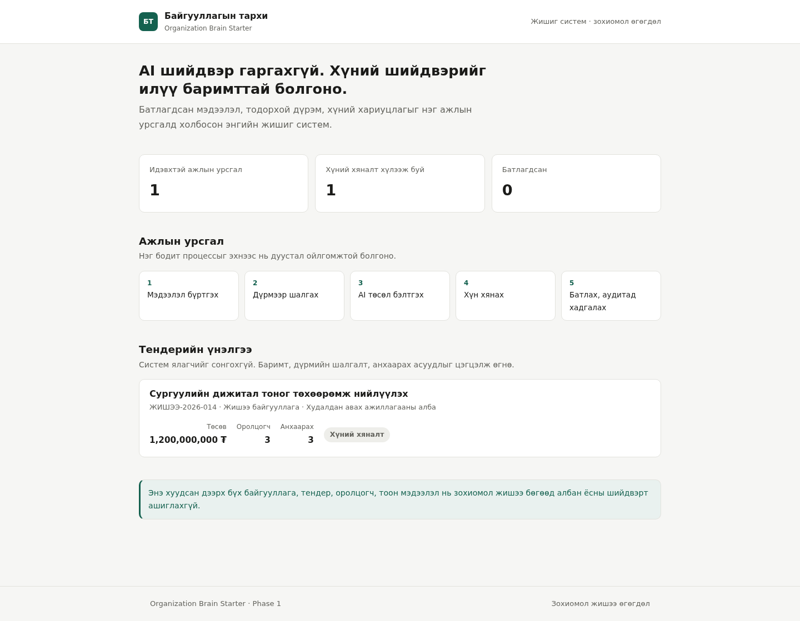
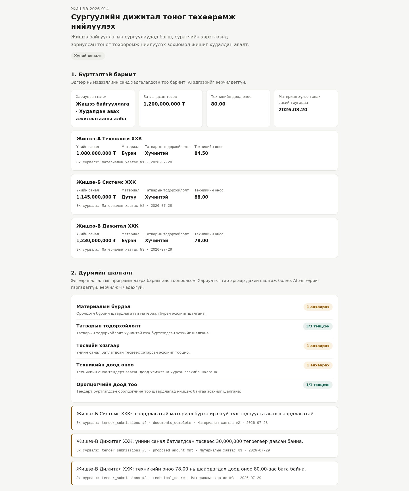
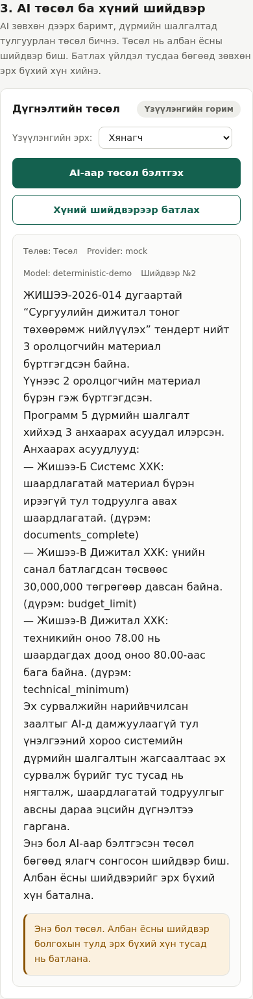

# Organization Brain Starter

A small, working **reference implementation** that connects organizational data, explicit rules, an AI API, human approval, and an audit trail around one understandable workflow.

It is aimed at ministries, agencies, state-owned enterprises, NGOs, and companies that want a practical starting point instead of a large "AI transformation" programme.

> **This is a reference implementation, not a production-ready procurement system.**
> All organizations, bidders, tenders, amounts, and document references in the current v0.1.x demonstration dataset are fictional. The demonstration role header is not authentication. Do not use this repository unchanged for an official decision.

> AI is not the organization's brain. Verified data, rules, workflows, decisions, and institutional memory are the brain. AI is a controlled assistant on top of that foundation.

## What this starter solves

Many organizations already have databases, documents, and reporting duties. The missing layer is usually a simple operational workflow that can:

1. hold structured information;
2. apply transparent rules;
3. identify missing or inconsistent evidence;
4. prepare an AI-assisted draft;
5. require a human decision; and
6. preserve an audit trail.

The first demonstration workflow is **AI-assisted tender evaluation**. It does not select a winner. It organizes evidence, runs explicit checks, flags issues, and drafts a review summary for an authorized person.

## Product principles

- Solve one real workflow first.
- Keep the interface simple enough for a non-technical leader.
- Use ordinary database queries and rules before advanced AI techniques.
- AI may prepare, compare, summarize, explain, and flag. Humans decide.
- Every important finding has a source, and every important action has an audit record.
- No RAG or vector database in Version 1.
- Provider-neutral AI connection. Mock mode works without an API key.

## Architecture

```text
Leader / Officer
       ↓
Minimal Next.js interface
       ↓
FastAPI application API
       ↓
PostgreSQL facts  →  deterministic rules (apps/api/app/rules.py)
       ↓
AI provider gateway (draft prose only)
       ↓
Mock provider or OpenAI-compatible API

Across the workflow:
source references · demo role boundary · explicit human approval · audit log
```

The important separation: **rule results are computed in Python from database rows**. They are passed to the model as read-only context. Nothing the model returns can change them.

## Screenshots

Every organization, official, bidder and amount shown below is fictional.



*Dashboard. The workflow in five steps and one fictional tender, before any approval.*



*Tender detail. Recorded facts and the five deterministic rule checks. Every finding names the exact row and document it came from.*



*Reviewer view at 390 px. The mock provider has written a draft. It is stored as a draft, and approving it is a separate action for an authorized person.*

## Quick start

### Requirements

- Docker Engine or Docker Desktop, with Docker Compose v2

### Run

```bash
git clone https://github.com/mootsoo/organization-brain-starter.git
cd organization-brain-starter
cp .env.example .env
docker compose up --build
```

Then open:

| What | Address |
|---|---|
| Web interface | <http://localhost:3000> |
| API documentation | <http://localhost:8000/docs> |
| API health | <http://localhost:8000/health> |

The default configuration is `AI_PROVIDER=mock`, so **no external AI key is required**.

To reload the fictional sample data from scratch:

```bash
docker compose down -v && docker compose up --build
```

## Phase 1 demonstration walkthrough

This is what an IT officer can click, and what each step proves.

| # | Action | What it proves |
|---|---|---|
| 1 | Open <http://localhost:3000> | The leadership dashboard runs and shows the workflow in five steps. |
| 2 | Open the sample tender | Structured facts are stored per bidder, each with a source reference. |
| 3 | Read section 2, "Дүрмийн шалгалт" | Five deterministic rules ran. Passing rules are shown too, not only failures. Each finding names the exact row and column it came from. |
| 4 | In section 3, set the demo role to **Ажиглагч (эрхгүй)** and press "AI-аар төсөл бэлтгэх" | The application boundary rejects the action. Nothing is created. |
| 5 | Set the role to **Хянагч** and press the same button | The mock provider writes a Mongolian draft with no API key. The draft repeats the rule findings and names the rule that produced each one, states that the exact source references were not sent to the AI and stay in section 2, and states in Mongolian that it is a draft, not a decision. |
| 6 | Look at section 4 and the tender status | The tender is still "Хүний хяналт". Generating a draft did not approve anything. |
| 7 | Keep the role **Хянагч** and press "Хүний шийдвэрээр батлах" | Approval is refused. Drafting and approving are different permissions. |
| 8 | Set the role to **Батлах эрх бүхий хүн** and press it again | The decision becomes approved and the tender stage changes to "Батлагдсан". |
| 9 | Read section 5, "Аудитын бүртгэл" | Both the AI generation and the human approval are recorded with actor, role, target, and time. |
| 10 | Run `docker compose down && docker compose up -d`, then reopen the tender | The approved decision and the audit records survive a restart. |

To run the same walkthrough automatically:

```bash
./scripts/smoke.sh                      # 25 checks against the running stack
RESTART_CHECK=1 ./scripts/smoke.sh      # also proves persistence across a restart
```

## Verification commands

```bash
# API: compile and tests (unit tests run anywhere; workflow tests need a database)
cd apps/api
pip install -r requirements.txt
python -m compileall app
PYTHONPATH=. pytest -q

# Frontend: dependency install and production build
cd apps/web
npm ci
npm run build

# Compose configuration
docker compose config --quiet

# Whole stack
docker compose up --build -d
docker compose ps          # db, api and web should all report (healthy)
./scripts/smoke.sh
```

The workflow tests in `apps/api/tests/test_api.py` skip themselves when no database is reachable at `DATABASE_URL`. GitHub Actions starts a PostgreSQL service and loads `database/init.sql`, so in CI they always run.

## Connect an AI API

The first external adapter supports any OpenAI-compatible chat-completions endpoint. Set these values in `.env`:

```env
AI_PROVIDER=openai-compatible
AI_BASE_URL=https://api.example.com/v1
AI_API_KEY=replace-me
AI_MODEL=replace-me
```

The application sends only the structured tender facts and the rule findings needed for the draft (see `build_model_input` in `apps/api/app/ai.py`). Internal row identifiers, document pointers (`evidence_reference`) and the raw `source_reference` row pointer are **not** sent; each finding reaches the provider as its `rule_id`, severity and Mongolian message only. Those source references remain available to people: they are returned by the API, shown under every finding in the interface, and stored with the draft in `decisions.source_snapshot`. The model is not given database access. If the provider fails, the API returns a clear recoverable error and no draft is stored.

## Repository map

```text
apps/web/              Minimal Next.js leadership interface
apps/api/app/main.py   Workflow endpoints and the approval boundary
apps/api/app/rules.py  Deterministic checks computed from database facts
apps/api/app/ai.py     Provider-neutral AI gateway (mock + OpenAI-compatible)
apps/api/tests/        Unit tests and end-to-end workflow tests
database/init.sql      Schema and fictional demonstration data
scripts/smoke.sh       End-to-end smoke test against a running stack
docs/                  Product, architecture, governance, roadmap, leadership guide
docker-compose.yml     Local three-service deployment
```

## Documentation

- [Product definition](docs/PRODUCT.md)
- [Technical architecture](docs/ARCHITECTURE.md)
- [Governance and safety](docs/GOVERNANCE.md)
- [Leadership guide in Mongolian](docs/LEADERSHIP_MN.md)
- [Implementation roadmap](docs/ROADMAP.md)

Technical documentation is written in English. The leadership-facing interface and `docs/LEADERSHIP_MN.md` are written in simple Mongolian.

## Known limitations

- The `X-Role` header is a visible software boundary, not authentication. Anyone who can reach the API can set it. A real deployment must connect it to an identity provider.
- Demonstration credentials in `.env.example` and `docker-compose.yml` are local defaults, not secrets, and must be replaced before any shared deployment.
- The rules are intentionally few and simple. Real procurement policy is larger and must be reviewed by the responsible officials.
- There is no document upload, no file storage, no search, and no reporting workflow in Phase 1.

## Status

**Phase 1: working foundation.** The goal is not to build a national platform in one step. The goal is to prove one understandable workflow end to end, then add only what real users need.

## License

Licensed under the [Apache License 2.0](LICENSE).
